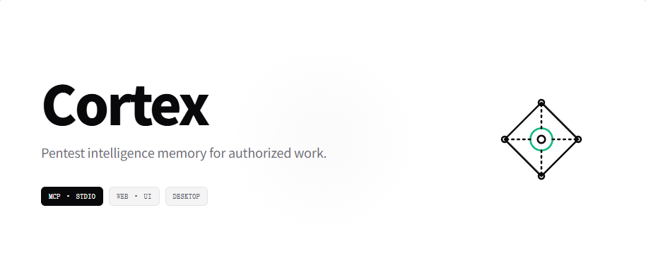

# Cortex

Cortex: local-first pentest intelligence hub. One SQLite memory shared by a pure stdio MCP server for agents, a ctx CLI and a desktop dashboard for humans. An optional browser Web UI serves the same dashboard on the local machine or a trusted intranet.

[](README.md)
[](README.zh-CN.md)
[](https://github.com/Revcloudi/Cortex/releases)
[](#mcp-access)
[](#cli-ctx)
[](#requirements)
[](LICENSE)

> **Authorized testing only.** Cortex is built for systems you own or have explicit written permission to test. You are responsible for complying with applicable laws, contracts and scope boundaries.

**English** · [简体中文](README.zh-CN.md) · [Web UI (intranet only)](#web-ui-intranet-only) · [Windows desktop app](#windows-desktop-app) · [CLI (ctx)](#cli-ctx) · [MCP tools](#mcp-access)

## Web UI (intranet only)

`ctx web` serves the same React UI from a local HTTP server that reads and writes the same SQLite file as the desktop app, the CLI and the MCP server. It is for **one user on the local machine or a trusted intranet**: there are no accounts, no multi-user access and no public deployment — never expose this port to the internet.

Build and start from a source checkout:

```bash
# Node.js >= 22.12 required
git clone git@github.com:Revcloudi/Cortex.git
cd Cortex
npm install
npm run build            # typecheck + Electron + MCP + CLI
npm run build:web        # Web SPA (required for ctx web)
npm run build:server     # Web HTTP server bundle (required for ctx web)
npm link                 # optional: expose `ctx` on PATH
ctx web
```

### Command-line options

Common options:

```bash
ctx web                                      # default 127.0.0.1:8787
ctx web --port 9000 --db /data/cortex.db     # explicit port and database
ctx web --host 192.168.1.20 --allow-intranet # trusted intranet only (explicit opt-in)
ctx web --no-open --json                     # no browser; JSON with tokenUrls, dbPath, readOnly…
```

| Option | Meaning |
| --- | --- |
| `--port <port>` | Listen port, default `8787` |
| `--host <host>` | Bind address, default `127.0.0.1`; any non-loopback address also requires `--allow-intranet` |
| `--db <path>` | SQLite file, default `~/.cortex/data.db` (`%USERPROFILE%\.cortex\data.db`) or `CTX_DB_PATH` |
| `--allow-intranet` | Explicit opt-in for a non-loopback bind on a trusted intranet |
| `--no-open` | Do not open a browser automatically |
| `--json` | Global flag; print machine-readable JSON (`tokenUrls`, `dbPath`, `readOnly`, `loopbackOnly`, `intranetAllowed`) |

### Logging in

Startup prints one or more login URLs containing a one-time token (`http://…/?token=…`). Opening one sets an `HttpOnly` + `SameSite=Strict` session cookie (12 h) and redirects so the token disappears from the address bar; reloads keep the session, restarting the server invalidates it. The token exists only in that URL — it is never logged, persisted or accepted from any other query string. Scripts may send `Authorization: Bearer <token>` instead of the cookie.

### Security red lines

- Default is loopback (`127.0.0.1`); a non-loopback bind is refused unless `--allow-intranet` is passed, and then it is only for a **trusted intranet**.
- On a server, allow only the private ranges in the firewall / security group (`10.0.0.0/8`, `172.16.0.0/12`, `192.168.0.0/16`). Never create a port mapping, public reverse proxy or tunnel for this port.
- Keep the SQLite file, the token and the logs out of any public directory.
- Treat the printed login URL as a secret: do not screenshot, share or paste it into chat tools. The token is never logged, and restarting the server invalidates the old link and prints a fresh one.
- Every API call requires the session cookie or Bearer token; HTML and static assets require it too. There is no CORS: only same-origin requests are accepted, `Host` is validated against DNS rebinding, and writes are additionally gated by `Origin` / `Referer` / `Sec-Fetch-Site`.
- Strict CSP, `X-Content-Type-Options: nosniff`, `Referrer-Policy: no-referrer`, `X-Frame-Options: DENY` and `Cache-Control: no-store` on API responses; 2 MB JSON body limit; per-IP rate limit (~300 requests / 10 s); errors are sanitized, and request logs never contain tokens, cookies or bodies. `/api/app`, `/api/db` and `/api/config` expose only the database file name, never its absolute path.

### Web vs desktop differences

- No frameless-window controls: the minimize/maximize/close buttons are hidden in a browser.
- The database is fixed by the server (`ctx web --db`); the sidebar row is a read-only display and the database picker is unavailable.
- Report export returns the Markdown to the browser and saves it as a download; the server writes nothing to disk.
- Clipboard uses `navigator.clipboard` with a legacy fallback; there is no native save dialog.
- **Connect agents** and first-run setup write agent configs on the machine running `ctx web`, not on the browser's machine; Web mode asks for confirmation first.
- `GET /api/events` (SSE) refreshes the UI when an agent, the CLI or the desktop app writes the database.
- If the SQLite file is not writable, the server starts in **read-only mode** (`/api/config` reports `readOnly: true`) and write APIs return 403 with a clear message.

### Optional intranet reverse proxy

If an internal TLS reverse proxy preserves a custom `Host`, add that hostname to the opt-in allow-list; keep the upstream on HTTP and add TLS plus extra authentication at the proxy:

```bash
CTX_WEB_ALLOWED_HOSTS=cortex.corp.example ctx web
```

### Installed build

`npm run build:runtime` copies `out/web` to `<install>/bin/web/` and `out/server/web.cjs` to `<install>/bin/web-server.cjs`; `npm run dist:win` runs `build:web` + `build:server` before packaging, so a freshly built installer includes the Web UI. A runtime built without the Web artifacts still works for CLI/MCP (it prints a warning); a half-built state (SPA present but server bundle missing) fails the build on purpose.

> Design rationale and the full security checklist: [docs/WEB_SUPPORT_DEVELOPMENT_GUIDE.md](docs/WEB_SUPPORT_DEVELOPMENT_GUIDE.md).

## Windows desktop app

The Windows installer is published to GitHub Releases by the release workflow. Current release: **cortex-v0.1.1**. macOS and Linux are supported through the CLI build below.

| Platform | Download |
| --- | --- |
| Windows 10/11 x64 | [Cortex-0.1.1-setup.exe](https://github.com/Revcloudi/Cortex/releases/latest/download/Cortex-0.1.1-setup.exe) |

> The link always points at the newest Cortex release; the full list is on the [Releases page](https://github.com/Revcloudi/Cortex/releases). The installer is unsigned: Windows SmartScreen may warn ("More info → Run anyway").

### Connect agents after installation

The installer only installs Cortex and its shortcuts. Start Cortex, open **MCP Access**, then either:

- click **Connect agents** — detects local agents, writes their MCP config and the bilingual skills (skill language follows the UI language), then restart the agent; or
- run `ctx init --yes` in a terminal (`ctx init --yes --agents dsh --skill-lang en` to choose explicitly).

Uninstalling removes the program only — `%USERPROFILE%\.cortex\data.db` is preserved. The UI supports **中文 / English switching** at any time; skill language can also be changed later with `ctx init --skill-lang`.

## CLI (ctx)

Runs on Node without Electron and reads the same SQLite database. All commands accept `--json`; exit codes are 0 success, 1 parameter/IO error, 2 data not found. Build and verify the command first:

```bash
# Node.js >= 22.12 required
git clone git@github.com:Revcloudi/Cortex.git
cd Cortex
npm install
npm run build            # typecheck + Electron + MCP + CLI
npm run build:web        # Web SPA (required for ctx web)
npm run build:server     # Web HTTP server (required for ctx web)
npm link                 # exposes `ctx` on PATH; without link: node out/cli/ctx.cjs
ctx --version            # verify the command works
ctx doctor               # verify DB, MCP runtime and agent configs
```

`npm run build` only builds the desktop app, CLI and MCP; the browser Web UI is a separate build — run `npm run build:web` and `npm run build:server` before using `ctx web` (see [Web UI (intranet only)](#web-ui-intranet-only)).

Other useful commands:

```bash
npm run dev          # Electron + Vite dev mode
npm run typecheck    # Node + Web TypeScript projects
npm start            # preview the built desktop app
npm run dist:win     # Windows installer (bundled Node runtime, artifact in release/)
```

The database is created on first launch at `%USERPROFILE%\.cortex\data.db` (macOS/Linux: `~/.cortex/data.db`); override with `CTX_DB_PATH`.

| Command | Description |
| --- | --- |
| `ctx init [--dry-run] [--yes] [--agents dsh,codex,claude,cursor] [--skill-lang zh\|en]` | Detect agents, show the planned diff, back up, then write MCP configs + skills + system rules |
| `ctx doctor` | Check database, schema, MCP/CLI runtime, agent configs, GUI install and versions |
| `ctx mcp print-config [agent]` | Print the stdio config snippet for DSH / Codex / Claude Code / Cursor |
| `ctx vulns list [--severity] [--host] [--limit]` | List vulnerabilities |
| `ctx vulns get <id>` | Show one full vulnerability: description, impact, interfaces, Markdown reproduction steps (HTTP requests/responses), remediation, retests and status |
| `ctx vulns export <id[,id...]> [--out <dir>] [--all] [--severity …] [--host …] [--limit …]` | Export Markdown reports using the same template as the desktop app; default output directory `./cortex-reports` |
| `ctx assets list [--search] [--status]` | List asset contexts |
| `ctx assets get <host_port>` | Show one asset context with full interfaces (raw requests), leaks and test parameters |
| `ctx snapshots list [--keyword]` | List cognitive snapshot sessions |
| `ctx snapshots get <session_id>` | Show one snapshot session |
| `ctx search <keyword>` | Search vulnerabilities, assets and snapshots together |
| `ctx open [--dev] [--path <exe>]` | Launch or focus the desktop app (Windows install or source build) |
| `ctx web [--port <port>] [--host <host>] [--db <path>] [--allow-intranet] [--no-open]` | Serve the same dashboard in a browser (loopback or trusted intranet only) |

## Daily workflow

Once installed, Cortex is the memory layer for every engagement:

1. **Findings go in through MCP.** While the agent hunts, it writes confirmed vulnerabilities, recon asset context and the current task snapshot into the local SQLite database (the installed skills/rules tell it when and how). No manual report assembly.
2. **Agents read the library back at any time.** Before a new task, the agent queries asset context and existing vulnerabilities, so recon is reused and duplicate findings are avoided.
3. **Humans review from the desktop app, the terminal or the optional browser Web UI.** The desktop app provides the vulnerability dashboard, asset library, snapshot sessions and Markdown report export. `ctx` provides vulnerability / asset / snapshot queries, full-text search, diagnostics and Markdown report export. `ctx web` serves the same pages to a browser on this machine or a trusted intranet.
4. **Resume a task in a new chat.** Just name the task, for example: *“Continue the Example Program IDOR task.”* The agent runs `manage_snapshot list`, loads the matching session (by project name, phase or `session_id`) and continues from `unfinished_tasks` / `next_steps`. If several sessions match, it asks you whether to continue one or create a new one.

```text
You:  continue the "Example Program" IDOR task and resume the unfinished checks
Agent: manage_snapshot(list) -> manage_snapshot(load, SESS-...) ->
       query_asset_context / query_vulnerabilities -> continue testing
```

## Features

- Vulnerability model: host, entry point, type, severity, URL, description, impact, affected interfaces, Markdown reproduction, remediation, crypto notes, test boundaries, append-only retests, related IDs and status.
- Asset context: full URLs, project, tech stack, structured interfaces (`path` / `method` / `params` / raw request), leaked info, non-secret `test_parameters` and related vulnerabilities. Legacy `interface_dir` arrays are normalized automatically.
- One MCP server with exactly six tools: `save_vulnerability`, `query_vulnerabilities`, `update_vulnerability`, `sync_asset_info`, `query_asset_context`, `manage_snapshot`.
- `ctx init` detects installed agents and writes their MCP config, the three skills and system-level hard rules idempotently (with backups, a dry-run mode and JSON / TOML / YAML validation).
- GUI: vulnerability dashboard with server-side filtering/pagination, asset library with interface explorer, cognitive snapshot sessions (project → child hierarchy), Markdown report export, and a compact bilingual MCP page with a one-click **Connect agents** action and the six-tool reference.
- Optional Web UI (`ctx web`): the same dashboard, asset library, snapshot and MCP pages in a browser on the same machine or a trusted intranet; one-time token login, no accounts, loopback-only by default, SSE refresh when the shared database changes.
- The sidebar database button can attach another Cortex SQLite file for browsing (desktop view only; agents keep using the default database).
- The main process watches the SQLite files (`data.db`, `-wal`, `-shm`) with chokidar and pushes `data:changed`, so agent writes usually show up in under a second without losing filters or open detail panels.
- Bilingual skills: `skills/zh/**` and `skills/en/**`; choose per installation.

## Requirements

- Node.js **≥ 22.12** for the CLI and source builds. The Windows desktop installer bundles its own Node runtime, so Windows end users do not need Node.
- The packaged desktop app is Windows 10/11 x64; macOS/Linux use the CLI build path.

## MCP access

The MCP server is **stdio only**: the agent starts it in its own process; there is no listening port and the GUI never starts MCP. Server name: `cortex`, version `0.1.1`.

| Scenario | Launch command |
| --- | --- |
| Source build | `node <repo>/out/mcp/stdio.cjs` |
| Windows install | `<install>\bin\node.exe <install>\bin\mcp-stdio.cjs` |

DeepSeek Harness (`~/.dsh/profiles/<profile>/cordis.patch.yml`):

```yaml
- insert:
    - id: mcp-cortex
      name: "@deepseek-ai/dsh-mcp-client"
      config:
        serverName: cortex
        transport: stdio
        command: "node"
        args:
          - "<repo>/out/mcp/stdio.cjs"
        toolCallTimeoutMs: 120000
```

Codex CLI (`~/.codex/config.toml`):

```toml
[mcp_servers.cortex]
command = "node"
args = ["<repo>/out/mcp/stdio.cjs"]
startup_timeout_sec = 20
tool_timeout_sec = 120
```

Claude Code:

```bash
claude mcp add --transport stdio cortex -- node <repo>/out/mcp/stdio.cjs
```

Cursor (`~/.cursor/mcp.json`):

```json
{
  "mcpServers": {
    "cortex": {
      "command": "node",
      "args": ["<repo>/out/mcp/stdio.cjs"]
    }
  }
}
```

### One-command setup

```bash
npm run build
node out/cli/ctx.cjs init --dry-run                    # preview only
node out/cli/ctx.cjs init --yes                        # detect agents, back up and write
node out/cli/ctx.cjs init --yes --agents dsh --skill-lang en
node out/cli/ctx.cjs doctor                            # diagnose config + runtime
```

`ctx init` backs up existing files as `.bak-YYYYMMDD-HHmmss`, merges marker-managed blocks idempotently (old `PENTEST` markers are migrated), validates JSON / TOML / YAML before writing, and installs the selected skill language. Restart the agent afterwards (not the GUI); then verify a read-only tool call such as `manage_snapshot({ "action": "list" })`.

## Skills (bilingual)

```
skills/
  zh/  vuln-db.skill.md  asset-context.skill.md  snapshot.skill.md
  en/  vuln-db.skill.md  asset-context.skill.md  snapshot.skill.md
```

`ctx init` copies the selected language to the agent skill directories (`~/.agents/skills/<name>/SKILL.md`, plus client-specific skill directories for Codex / Claude Code). The desktop MCP page and the installer both use the same generator, so configs and skills never drift apart.

## Packaging and releases

```bash
npm run dist:win           # build + bundled runtime → Windows x64 NSIS installer (release/Cortex-0.1.1-setup.exe)
npm run build:runtime      # only materialize runtime/ (manual/advanced packaging)
```

The installed layout (per-user on Windows):

```text
%LOCALAPPDATA%\Programs\Cortex\
  Cortex.exe                                    Electron shell
  resources/app.asar                            main / preload / renderer bundles
  bin\
    node.exe                                    bundled Node LTS runtime
    mcp-stdio.cjs                               stdio MCP entry
    ctx.cjs  ctx.cmd                            CLI + wrapper
    ctx-path.cjs                                installer PATH helper
    web-server.cjs                              HTTP server bundle for ctx web
    web\                                        standalone Web UI (index.html + hashed assets)
    skills\{zh,en}\...                          skill sources for ctx init
    node_modules\                               better-sqlite3 (Node-API)
```

`.github/workflows/release.yml` builds the Windows installer on `v*` / `cortex-v*` tags and publishes it to GitHub Releases. macOS/Linux use the CLI build (see [CLI (ctx)](#cli-ctx) above), so no macOS artifacts are produced.

## Project layout

```text
src/
  shared/      shared contracts (types, IPC channels, Zod schemas, MCP config generator)
  core/        Electron-free database, paths, logging, version
  mcp/         pure stdio MCP server and the six tools
  cli/         ctx commands and agent config writers
  server/      ctx web HTTP server (auth, security, static SPA, REST/SSE routes)
  main/        Electron main process (IPC, file watcher, database switching, no MCP server)
  preload/     contextBridge API
  renderer/    React UI + lightweight zh/en i18n (messages in renderer/src/i18n)
skills/        bilingual agent skills (zh / en)
scripts/       build, runtime, packaging and legacy install scripts
build/         NSIS customizations
```

## Data and concurrency

- Default database: `%USERPROFILE%\.cortex\data.db` (Windows) or `~/.cortex/data.db`; override with `CTX_DB_PATH` (legacy `PDH_DB_PATH` is still honoured).
- `PRAGMA journal_mode=WAL`, `busy_timeout=5000`, `synchronous=NORMAL`, `foreign_keys=ON`; write transactions use `BEGIN IMMEDIATE` with bounded SQLITE_BUSY retries; schema version lives in `PRAGMA user_version`.
- Migrations run in one immediate transaction, so concurrent agent processes cannot partially migrate a database.
- The database is plaintext, including credentials in `leaked_infos` — an explicit trade-off of this version.

## Security and engineering constraints

- **MCP is stdio only**: the MCP server has no listening port; the agent starts it and it lives and dies with that agent. stdout carries JSON-RPC frames only; logs go to stderr or `CTX_MCP_LOG`. The optional Web UI (`ctx web`) is a separate token-authenticated HTTP server that is off unless started, loopback-only unless `--allow-intranet` is passed.
- **Process isolation**: `contextIsolation` + `sandbox`, no `nodeIntegration`; the desktop renderer talks only to `window.api` and the main process re-validates every IPC payload (the browser Web build uses same-origin HTTP instead, see [Web UI](#web-ui-intranet-only)).
- **Zod validation** at MCP and IPC boundaries; parameterized SQL everywhere.
- **Concurrency**: WAL, busy timeout, immediate transactions and retries keep transient lock contention away from tool calls.

## License

MIT. See [LICENSE](LICENSE).
